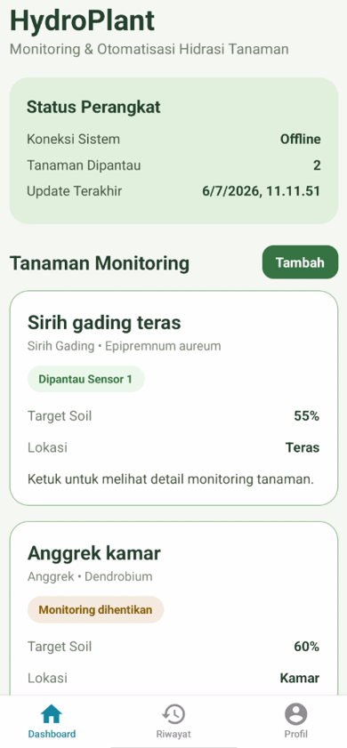
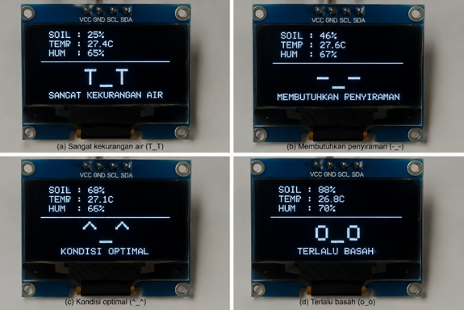
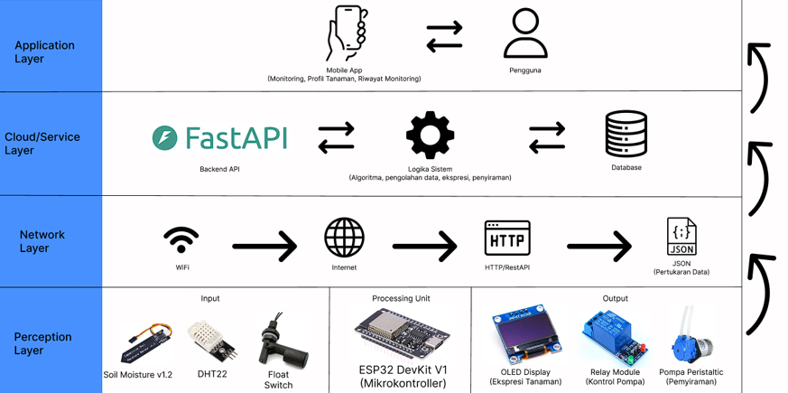

# HydroPlant 🌱
### IoT-Based Smart Plant Monitoring and Automatic Irrigation System

HydroPlant is an IoT-based plant monitoring and automatic irrigation system that monitors soil moisture and environmental conditions to determine appropriate watering requirements.

The system integrates an ESP32 microcontroller, a Python FastAPI backend, Supabase, and a React Native mobile application. It uses a **Simulated Annealing optimization algorithm** to calculate suitable watering volumes based on soil moisture targets and environmental conditions.

## 📸 Screenshots

### Mobile Dashboard



### ESP32 OLED Display



## ✨ Key Features

- **Soil Moisture Monitoring:** Monitors soil moisture levels using an ESP32-connected sensor.
- **Environmental Monitoring:** Measures temperature and air humidity using a DHT22 sensor.
- **Automatic Irrigation:** Controls water pump operation based on plant moisture requirements.
- **Simulated Annealing Optimization:** Determines suitable watering volumes using an optimization algorithm.
- **Nutrient Scheduling:** Checks nutrient application intervals based on plant profiles.
- **Plant Condition Classification:** Represents plant conditions through a rule-based emotion system.
- **Water Availability Detection:** Monitors water tank availability using a float sensor.
- **Mobile Monitoring:** Displays plant conditions, monitoring history, and system status.

## 🏗️ System Architecture

HydroPlant consists of four main components:

1. **ESP32 Firmware:** Collects sensor readings and controls irrigation pumps.
2. **Backend API:** Processes sensor data and calculates irrigation decisions.
3. **Supabase:** Stores plant profiles, monitoring configurations, and monitoring records.
4. **Mobile Application:** Provides a user interface for monitoring and plant management.

### Communication Flow

- ESP32 communicates with the FastAPI backend through HTTP.
- FastAPI retrieves and stores data in Supabase.
- The mobile application communicates directly with Supabase.



## 🛠️ Technology Stack

| Component | Technologies |
|---|---|
| Microcontroller | ESP32 |
| Firmware | C++, Arduino Framework |
| Backend | Python, FastAPI |
| Optimization | Simulated Annealing |
| Database | Supabase |
| Mobile Application | React Native, Expo |
| Programming Language | TypeScript |
| API Communication | HTTP, JSON |

## 📂 Project Structure

```text
HydroPlant/
├── README.md
│
├── backend/
│   ├── main.py
│   ├── emotion.py
│   ├── sa_irrigation.py
│   └── .env.example
│
├── firmware/
│   └── esp32/
│       └── ESP32-Dev-Kit1-Hydro-plant.ino
│
├── mobile/
│   ├── app/
│   ├── components/
│   ├── constants/
│   ├── hooks/
│   ├── lib/
│   ├── assets/
│   ├── package.json
│   └── .env.example
│
└── docs/
    ├── architecture/
    │   └── system-architecture.png
    ├── screenshots/
    │   ├── dashboard.png
    │   └── OLED-plant-status.png
    └── project-doc.md
```

## 🚀 Getting Started

HydroPlant consists of multiple components that need to be configured separately.

### Prerequisites

- Python
- Node.js and npm
- Arduino IDE
- ESP32 board support for Arduino IDE
- A Supabase project

### 1. Clone the Repository

```bash
git clone https://github.com/Irham442/HydroPlant.git
cd HydroPlant
```

### 2. Backend Configuration

Navigate to the backend directory:

```bash
cd backend
```

Configure the required environment variables in a `.env` file:

```env
SUPABASE_URL=your_supabase_project_url
SUPABASE_KEY=your_supabase_key
```

Install the backend dependencies and run the FastAPI application.

*Note: Backend dependency installation instructions will be added after the dependency configuration is finalized.*

### 3. ESP32 Firmware Configuration

Open the firmware file:

```text
firmware/esp32/ESP32-Dev-Kit1-Hydro-plant.ino
```

Configure the following settings in the firmware:

- Wi-Fi SSID
- Wi-Fi password
- Backend server address

Install the required Arduino libraries, select the appropriate ESP32 board, and upload the firmware.

### 4. Mobile Application Configuration

Navigate to the mobile application directory:

```bash
cd mobile
```

Create a `.env` file using the following variables:

```env
EXPO_PUBLIC_SUPABASE_URL=your_supabase_project_url
EXPO_PUBLIC_SUPABASE_KEY=your_supabase_publishable_key
```

Install dependencies:

```bash
npm install
```

Start the Expo development server:

```bash
npx expo start
```

## 📖 Documentation

For detailed technical information, refer to:

- [Project Technical Documentation](docs/project-doc.md)
- [System Architecture](docs/architecture/system-architecture.png)

The technical documentation covers hardware components, firmware implementation, backend architecture, the Simulated Annealing algorithm, database structure, mobile application, and system limitations.

## ⚠️ Current Limitations

- The current firmware and mobile application configuration supports sensor number 1.
- Simulated Annealing calibration data is based on Sirih Gading testing.
- The mobile application does not implement user authentication.
- Manual watering through the mobile application is not currently available.
- The optimization model and environmental factors are subject to the limitations of their calibration and heuristic assumptions.

## 👨‍💻 Project Status

HydroPlant is a consolidated IoT project combining embedded systems, backend development, database integration, and mobile application development.

The repository brings the firmware, backend, and mobile application together in a single monorepo for easier maintenance and development.